<a href="https://sunguohao.space"></a>

南京林业大学计算机科学与技术 2025 级，一言学社联合创始人。做过嵌入式控制、Web 全栈和 AI 应用，最近在做 3D 创作工具和多 Agent 协作。 
CS undergraduate at Nanjing Forestry University and co-founder of OneSay. Embedded control, full-stack web and applied AI; lately 3D creation tools and multi-agent workflows.

  

### 荣誉

<a href="https://sunguohao.space"></a>

2026 苏客松赛道二 AI+医疗健康冠军（知达 / MR COACH，负责测试与质量保障、产品与路演材料）；影石 Insta360 BOLD MAKER 2026 全国 Top 5（Along 一起游）；TI 杯电子设计竞赛获奖（HCAR）。 
Track champion at the 2026 苏客松 hackathon (AI + Healthcare), national Top 5 at Insta360 BOLD MAKER 2026, and an award at the TI Cup electronic design contest.

### 捏个 PINCH

<a href="https://github.com/NLTuring/pinch"></a>

说一句话，捏出一个能拿在手里的东西。打开就是一团泥：堆、挖、抹、压、抓、刻六种笔刷，左右对称和拉坯，每一笔都能撤销并保留分支；也可以直接说"高一点""加个盖子"。捏完做打印体检（水密、壁厚、悬垂、能否站稳），导出 3MF / STL / OBJ / GLB。Web 和 Windows / macOS 桌面端共用一套界面，不配云端模型也能完整使用。 
Describe it, sculpt it like clay, check it for printing, export it. Voxel SDF clay engine in a Web Worker, branching undo, Web and desktop from one codebase.

### Along 一起游

<a href="https://github.com/NLTuring/along"></a>

面向来华外国游客的旅行陪伴 App：落地有人接，同游有朋友，回国带得走。按落地时间生成 3/5/7 天行程，匹配本地志愿者和持证向导，把旅途照片做成浮雕冰箱贴；适老版与中英双语。仓库包含手机端、服务端、管理端、官网与设计工程。团队作品，我是团队成员；获影石 Insta360 BOLD MAKER 2026 全国 Top 5。 
A travel companion for visitors to China: day plans by local time, local friends and guides, photo-to-relief keepsakes. A team project, national Top 5 at Insta360 BOLD MAKER 2026.

### 啄木鸟 Woodpecker

<a href="https://github.com/NLTuring/Woodpecker-Platform"></a>

面向农田长势监测和森林健康巡查的遥感分析平台。我负责 Web 前端与 AI 应用：地块台账、多源数据导入和 NDVI 影像叠加，串成从任务下达到处方报告的八步闭环。先把影像解译成可复核的定量指标，再交给 DeepSeek 做长势诊断和病虫害推演，强制输出结构化 JSON；密钥只放在服务端代理里，带限流和超时熔断。已申报「互联网+」创新创业大赛。 
Remote sensing is decoded into NDVI and canopy metrics first, then DeepSeek returns structured diagnoses through a same-origin proxy with rate limits and timeouts. I built the web front end and the AI layer.

### HCAR 稳球小车

<a href="https://github.com/NLTuring/HCAR"></a>

TI 杯电子设计竞赛获奖作品，我参与了硬件选型、代码开发与系统联调。TI MSPM0G3507 负责实时控制：八路灰度循迹、JY61P 姿态、编码器测速，用串级 PID 驱动 TB6612；RK3576（泰山派）用自适应阈值和卡尔曼滤波追踪车上的钢球，通过自定义 5 字节串口协议把坐标发给单片机，丢球时停发数据，由下位机超时保护。 
An award-winning TI Cup entry: line following and cascade PID on a TI MSPM0G3507, Kalman-filtered ball tracking on an RK3576, linked by a 5-byte UART protocol with a lost-ball timeout.

### agent-fleet

<a href="https://github.com/NLTuring/agent-fleet"></a>

把 ZCode、Codex、Claude Code 等 8 个编程 Agent 接到同一个调度内核上。按历史表现派单，每个任务在独立 worktree 里跑，只有验收命令全部通过的改动才会提交并放行下游；失败时带着交接单换人接力，越权决定由内核拒绝。附桌面托盘应用和手机端审批。运行时只用 Python 标准库。 
Routes tasks across eight coding agents, gates every change on its checks, relays failures with a hand-off note. Desktop tray app and phone approvals; pure standard-library Python.

### 沙盘城

<a href="https://github.com/NLTuring/shapan-city"></a>

青禾市的两千个市民按各自的工作、住房、存款和脾气过日子，替你把一条政策先过一遍：外卖抽成、租金上限、限价、补贴……每个方案跑几十遍，报告说明会发生什么、谁受益谁受损，以及结论该信几分（配对随机数、bootstrap 区间、敏感性标签、12 条经济学规律校准）。定位是压力测试想法，不是预测。 
Two thousand rule-driven residents stress-test a policy: paired seeds, bootstrap intervals, robustness labels and twelve textbook checks. For finding consequences, not for forecasting.

### 费曼学习陪练

<a href="https://github.com/NLTuring/feynman-coach"></a>

学完一个概念，讲给 AI 扮演的小白学生"小问"听。小问听不懂就追问；讲完后给你一份诊断报告，指出哪里讲错、哪里跳过了步骤，每条批评都引用你的原话，判错了可以申诉。不配密钥也能用演示模式完整走一遍。 
Explain a concept to a curious AI beginner; get a report that quotes your own words for every critique.

### 更早的项目

<a href="https://github.com/NLTuring/?tab=repositories"></a>

协会协作平台、像素飞行游戏、博客，以及 12 个三维交互与边缘 AI 方向的原型。 
A society platform, a pixel flight game, a blog and twelve prototypes in 3D interaction and edge AI.

更早的项目和原型 / earlier work

| 项目 | 做什么 | 技术 |
| :-- | :-- | :-- |
| [创智算](https://github.com/NLTuring/czsweb) | 高校数字科技协会协作平台：成员鉴权、社费核验、竞赛库与组队审批，独立开发上线 | `Node.js` `PostgreSQL` `Vercel` |
| [像素飞机](https://github.com/NLTuring/pixel-plane) | 单个 HTML 文件的像素风飞行游戏，世界、飞机与音效全由代码生成 | `WebGL2` `Web Audio` |
| [sghblog](https://github.com/NLTuring/sghblog) | Django 博客：富文本、代码高亮、XSS 过滤、全文检索 | `Django 5` `Bootstrap 5` |
| [空序](https://github.com/NLTuring/urban-low-altitude-uav-planning) | 城市低空多机调度与航迹冲突消解原型 | `React` `Three.js` |
| [知行](https://github.com/NLTuring/zhixing-embodied-platform) | 具身智能任务规划与 IK 仿真评测原型 | `TypeScript` `Three.js` |
| [愈缝](https://github.com/NLTuring/seamheal) | 3D 网格修复与接缝优化工作台原型 | `FastAPI` `OpenCV` `WebGL` |
| [医学影像质控](https://github.com/NLTuring/imaging-quality-workbench) | DICOM 质控、结构化报告与三维解剖台原型 | `React 19` `R3F` |
| [肤镜](https://github.com/NLTuring/rk3576-skin-diagnosis) | 三维人体索引、本地优先的皮肤观察手账原型 | `React` `IndexedDB` |
| [仓境](https://github.com/NLTuring/cangjing-grain-platform) | 粮仓三维数字孪生原型 | `R3F` `Express 5` |
| [安步](https://github.com/NLTuring/anbu-fall-risk-prediction) · [息间](https://github.com/NLTuring/xijian-rk3576) | 步态跌倒风险、夜间呼吸声学，RK3576 边缘端原型 | `Python` `TypeScript` |
| [益望](https://github.com/NLTuring/eco-beneficial-monitoring) · [田野切片](https://github.com/NLTuring/weeding-robot-workstation) · [留量大脑](https://github.com/NLTuring/liuliang-brain) · [拾艺](https://github.com/NLTuring/heritage-skill-training) | 农林生态、除草规划、县域电商、非遗传习方向的原型与方案 | `React` `Three.js` `Vite` |

### 一言学社 OneSay

<a href="https://onesay.tokennext.top"></a>

我是一言学社联合创始人。一言学社是一个源自高校的青年科技社区，1600+ 位年轻的创造者，来自 15 所高校、8 座城市。 
I co-founded OneSay, a youth tech community born on campus: 1,600+ builders from 15 universities in 8 cities.

### 常用工具

| | |
| :-- | :-- |
| Web | `TypeScript` `React` `Vue 3` `Node.js` `Fastify` `Django` `FastAPI` `PostgreSQL` `SQLite` |
| 3D 与图形 | `Three.js` `React Three Fiber` `WebGL2` `SDF / 体素` `Blender GLB` |
| AI 应用 | `LLM 结构化输出` `多 Agent 编排` `语音识别` `DeepSeek` `OpenAI 兼容接口` |
| 嵌入式 | `C` `TI MSPM0G3507` `RK3576` `PID` `Kalman` `Linux` |
| 工程 | `Electron` `Docker` `Playwright` `Vitest` `pytest` |

  

